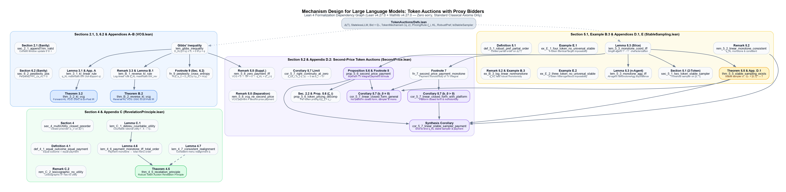

# Mechanism Design for Large Language Models: Token Auctions with Proxy Bidders — Lean 4 Formalization

This package contains a complete, self-contained **Lean 4** (`leanprover/lean4:v4.27.0` + **Mathlib** `v4.27.0`) formalization accompanying the manuscript:

> **Mechanism Design for Large Language Models: Token Auctions with Proxy Bidders**  
> Anonymous Author(s)

It formalizes every definition, lemma, proposition, theorem, corollary, remark, formal footnote claim, and counterexample across Sections 2–6 and Appendices A–E (`7,260` lines across `7` Lean files, `33` exported theorems):

- **Section 2 & Section 6.2 (Model & Sequence Perplexity):** Finite token vocabularies $T$, simplex $\Delta(T)$, bounded-window autoregressive sequences $s \oplus \tau$ (sanity lemma `sec_2_1_appendTrim_valid`), stateless and prompt-tuned proxy LLMs $f_i(s) = f(s_0^i \oplus s)$, rational scalar bids $\mathbb{Q}_+$, conditional per-token pricing functions $\zeta_i$ and admissible payment rules, sequence perplexity positivity $\mathrm{PPL}_i(s_m) > 0$ (sanity lemma `sec_6_2_perplexity_pos`), and the cross-entropy / reverse-KL decomposition (**Footnote 9**).
- **Section 3 & Appendices A–B (Idealized KL-Divergence Benchmark):** Gibbs' inequality, unique maximization of forward-KL social welfare over full-support $q \in \Delta(T)$ by the linear aggregation rule $q_{\mathrm{KL}}$ (**Lemma 3.1**), joint Dominant-Strategy Incentive Compatibility and Ex-Post Individual Rationality of the forward-KL VCG mechanism over admissible full-support reports (**Theorem 3.2**), and the parallel log-linear aggregation rule $\bar{q}_{\mathrm{KL}}$ and reverse-KL VCG mechanism (**Remark 3.3**, **Lemma B.1**, **Theorem B.2**).
- **Section 4 & Appendix C (Partial Preference Orders & Revelation Principle):** Closed multi-utility preorders (`sec_4_multiUtility_closed_preorder`), equal-outcome payment equality under **Definition 4.1**, countable rational utility representation $f : X \to \mathbb{Q}_+$ (**Lemma C.1**), non-representability of lexicographic preferences on $\mathbb{R}^2$ (**Remark C.2**), menu total-order characterization of payment monotonicity (**Lemma 4.6**), consistent menu realignment (**Lemma 4.7**), and the Revelation Principle for robust token auctions (**Theorem 4.5**).
- **Section 5.1, Example B.3 & Appendices D.1, E (Robust Preferences & Stable Sampling):** Partial-order and closedness properties of robust preferences (**Definition 5.1**), robust monotonicity and consistency of $q_{\mathrm{KL}}$ vs. failure of robust monotonicity for $\bar{q}_{\mathrm{KL}}$ (**Remark 5.2** & **Example B.3**), single-agent slice and $n$-agent coordinatewise $T^+ / T^-$ monotonicity characterizations (**Lemma 5.3**), the 2-token threshold sampler on $[0, 1]$, existence of a stable sampling implementation $\sigma : \mathbb{Q}_+ \times [0, 1]^2 \to T$ for every monotone rule (**Theorem 5.5**), and impossibility of universally stable sampling even for $n = 2$ with identical targets on $|T| = 4$ (**Example E.1**) or heterogeneous targets on $|T| = 3$ (**Example E.2**).
- **Section 5.2 & Appendix D.2 (Second-Price Token Auctions):** Sampler-independent Myerson total-variation integral characterization of expected second-price payments, per-token charging identities on $T^+ / T^-$, conditional per-token pricing decomposition $z_i(b, p) = \mathbb{E}_{t \sim q(b, p)}[\zeta_i(b, p, t)]$, and invariance across antitone extensions (**Proposition 5.6**, **Section 2.2**, & **Footnote 8**), payment monotonicity on positive bids and under right-continuity at $0$ (**Footnote 7**), closed-form linear second-price payments, monotonicity, stable-sampler realization, and right-continuity at $0$ both with ($b_0 > 0$) and without ($b_0 = 0$) a platform bidder (**Corollary 5.7**), and non-coincidence between forward-KL VCG and second-price payments alongside a supplementary zero-payment characterization (**Remark 5.8**).

Every declaration compiles without `sorry`, `admit`, `unsafe`, `native_decide`, or custom axioms. Every theorem depends only on Lean's three standard classical axioms (`propext`, `Classical.choice`, `Quot.sound`); see [Building and Verifying](#building-and-verifying).

---

## Dependency Graph



Each node represents an exported theorem in namespace `TokenAuctions`. Solid arrows `A --> B` indicate that the Lean proof of `B` invokes `A` (directly or through private file-local helpers); the dashed arrow from Lemma 4.7 to Theorem 4.5 indicates that both theorems instantiate the shared private realignment lemma `realign_mechanism_master` in [`TokenAuctions/RevelationPrinciple.lean`](TokenAuctions/RevelationPrinciple.lean). Nodes without incoming arrows are proved directly from [`TokenAuctions/Defs.lean`](TokenAuctions/Defs.lean) and Mathlib.

```mermaid
flowchart TD
    subgraph P1["Sections 2.1, 3, 6.2 & Appendices A–B (VCG.lean)"]
        S21["Sec. 2.1 sanity (sec_2_1_appendTrim_valid): context window update"]
        Gibbs["Gibbs' Inequality (lem_gibbs_inequality)"]
        L31["Lemma 3.1 (lem_3_1_kl_linear_rule): linear rule q_KL"]
        T32["Theorem 3.2 (thm_3_2_kl_vcg): Forward-KL VCG"]
        LB1["Remark 3.3 & Lemma B.1 (lem_B_1_reverse_kl_rule): log-linear rule"]
        TB2["Theorem B.2 (thm_B_2_reverse_kl_vcg): Reverse-KL VCG"]
        S62["Sec. 6.2 sanity (sec_6_2_perplexity_pos): PPL > 0"]
        Fn9["Footnote 9 (fn_9_perplexity_cross_entropy)"]
        Gibbs --> L31 --> T32
        Gibbs --> LB1 --> TB2
        Gibbs --> Fn9
    end

    subgraph P2["Section 4 & Appendix C (RevelationPrinciple.lean)"]
        S4mu["Sec. 4 (sec_4_multiUtility_closed_preorder)"]
        D41["Def. 4.1 (def_4_1_equal_outcome_equal_payment)"]
        LC1["Lemma C.1 (lem_C_1_debreu_countable_utility)"]
        RC2["Remark C.2 (rem_C_2_lexicographic_no_utility)"]
        L46["Lemma 4.6 (lem_4_6_payment_monotone_iff_total_order)"]
        L47["Lemma 4.7 (lem_4_7_consistent_realignment)"]
        T45["Theorem 4.5 (thm_4_5_revelation_principle)"]
        LC1 --> L46 --> T45
        L47 -.-> T45
    end

    subgraph P3["Section 5.1, Example B.3 & Appendices D.1, E (StableSampling.lean)"]
        D51["Def. 5.1 (def_5_1_robust_pref_partial_order)"]
        R52["Remark 5.2 (rem_5_2_linear_monotone_consistent)"]
        ExB3["Remark 5.2 & Example B.3 (ex_B_3_log_linear_nonmonotone)"]
        L53["Lemma 5.3 slice (lem_5_3_monotone_coord_iff)"]
        L53n["Lemma 5.3 n-agent (lem_5_3_monotone_agg_iff)"]
        S2tok["Sec. 5.1 (sec_5_1_two_token_stable_sampler)"]
        T55["Theorem 5.5 (thm_5_5_stable_sampling_exists)"]
        ExE1["Example E.1 (ex_E_1_four_token_no_universal_stable)"]
        ExE2["Example E.2 (ex_E_2_three_token_no_universal_stable)"]
        L53 --> L53n
        L53 --> S2tok
        L53 --> T55
    end

    subgraph P4["Section 5.2 & Appendix D.2 (SecondPrice.lean)"]
        P56["Proposition 5.6 & Footnote 8 (prop_5_6_second_price_payment)"]
        P56z["Sec. 2.2 & Prop. 5.6 (prop_5_6_token_pricing_decomp)"]
        Fn7["Footnote 7 (fn_7_second_price_payment_monotone)"]
        C57a["Corollary 5.7, b_0 > 0 (cor_5_7_linear_closed_form_with_platform)"]
        C57b["Corollary 5.7, b_0 = 0 (cor_5_7_linear_closed_form_general)"]
        C57c["Corollary 5.7 limit (cor_5_7_right_continuity_at_zero)"]
        C57s["Synthesis (cor_5_7_linear_stable_sampler_payment)"]
        R58a["Remark 5.8 suppl. (rem_5_8_zero_payment_iff)"]
        R58b["Remark 5.8 (rem_5_8_vcg_ne_second_price)"]
        P56 --> P56z
        Fn7 --> C57a
        Fn7 --> C57b
        P56 --> C57b
        P56 --> C57s
        C57a --> C57s
    end

    L53 --> P56
    L53 --> Fn7
    T55 --> C57b
    R52 --> C57s
    T55 --> C57s
    Gibbs --> R58a
```



### Proof-Route Notes

1. **Countable utility representation in Lemma C.1 (`lem_C_1_debreu_countable_utility`).** Proved constructively via a one-directional inductive enumeration (`Nat.rec` combined with the rational gap selector `gapBid` / `gapBid_spec`): at step $k$, if the $k$-th element is indifferent to some earlier element, it reuses the smallest such index's assigned rational value (so $f : X \to \mathbb{Q}_+$ is constant on indifference classes without requiring quotient types or topological assumptions); otherwise `gapBid` places a strictly positive rational strictly between the finite sets of already-assigned lower and upper values. By contrast, `realign_complete_preorder_on_bids` in `RevelationPrinciple.lean` uses a two-step alternating back-and-forth recursion to surject $\mathbb{Q}_+$ onto a dense order-realigned parametrization.
2. **Consistent realignment in Lemma 4.7 and Theorem 4.5.** Both `lem_4_7_consistent_realignment` and `thm_4_5_revelation_principle` instantiate the master realignment lemma `realign_mechanism_master`, which simultaneously reparametrizes the aggregation rule $\tilde{q}$ and transports the payment rule $\tilde{z}$ along an explicit right-inverse bid map while preserving admissibility (`z_i(0, b_{-i}, p) = 0`), payment monotonicity, and both strategic equivalence and unilateral-deviation equivalence (without requiring preferences to be private-values or topologically closed).
3. **Measure-theoretic stable sampling in Theorem 5.5 (`thm_5_5_stable_sampling_exists`).** Formalized directly on the two-dimensional Lebesgue unit square $([0, 1]^2, \mathrm{Leb}|_{[0,1]} \otimes \mathrm{Leb}|_{[0,1]})$, covering all boundary regimes ($m = M$ constant curve and $m < M$ strictly increasing total undersampled mass, including rational supremum attainment vs. strict asymptotic limit $Q^+(b_i) < M$ for all $b_i \in \mathbb{Q}_+$).
4. **Riemann/Lebesgue integral bridge on $\mathbb{Q}_+$ in Proposition 5.6 (`prop_5_6_second_price_payment` & `prop_5_6_token_pricing_decomp`).** Because bids lie in $\mathbb{Q}_+$ (**Section 2.2** & **Footnote 8**), `Defs.lean` defines the canonical antitone real extension `l1DistRealExt` (`sInf` over $\{b \in \mathbb{Q}_+ : b \le x\}$), monotone per-token extension `tokenProbUnderExt` (`sSup`), and conditional per-token pricing function `myersonTokenPricing`. `prop_5_6_second_price_payment` proves both the canonical `myersonTVPayment` equality and invariance across *every* antitone real extension $G : [0, b_i] \to \mathbb{R}$ agreeing with $b' \mapsto \|q(b') - p_i\|_1$ on $\mathbb{Q}_+$, and `prop_5_6_token_pricing_decomp` verifies $z_i(b, p) = \mathbb{E}_{t \sim q(b, p)}[\zeta_i(b, p, t)]$.

---

## How the Paper's Objects and Scope Are Modeled in Lean

All shared definitions reside in [`TokenAuctions/Defs.lean`](TokenAuctions/Defs.lean):

- **Simplex, support, and KL conventions (`TokenDist T`, `HasFullSupport`, `klDiv`).** `TokenDist T` represents $\Delta(T)$ over any finite type `[Fintype T]` with nonnegative coordinates summing to $1$, equipped with the subspace topology inherited from $\mathbb{R}^T$ and $L_1$ / total-variation distances `l1Dist` and `tvDist`. Section 3's untruncated-softmax interior condition ($p_j(t) > 0$ for all $t \in T$) is captured by `HasFullSupport`. Because Lean defines `Real.log 0 = 0`, `klDiv p q` evaluates to a finite number rather than $+\infty$ if $q(t) = 0 < p(t)$; accordingly, forward-KL welfare maximization (`lem_3_1_kl_linear_rule`) quantifies over full-support $q \in \Delta(T)$ (outside full support, mathematical $\mathrm{SW}(q) = -\infty$), and joint DSIC in `thm_3_2_kl_vcg` and `thm_B_2_reverse_kl_vcg` quantifies over admissible full-support reported distributions $p'_i$. Reverse-KL maximization (`lem_B_1_reverse_kl_rule`) holds over all $q \in \Delta(T)$.
- **Rational scalar bids (`Bid := NNRat`).** Following Section 2.2 ($b_i \in \mathbb{Q}_+$), scalar bids are nonnegative rationals `NNRat`. Profile surgery helpers `joinBid` / `restrictBids` and `joinDist` / `restrictDists` represent $(b_i, b_{-i})$ and $(p_i, p_{-i})$ cleanly without index renumbering.
- **Platform bidder (`b₀ > 0`) vs. pure strategic profiles (`b₀ = 0`).**
  - In Section 3 and the platform-anchored statements of Section 5, `linearAggRule b₀ hb₀ p₀` and `logLinearAggRule b₀ hb₀ p₀` incorporate the non-strategic platform bidder $0$ with fixed bid $b_0 > 0$ and baseline distribution $p_0$, guaranteeing $B = b_0 + \sum_{i=1}^n b_i > 0$ and $B_{-i} > 0$.
  - For Example B.3 and the general $B_{-i} \ge 0$ statement of Corollary 5.7 (`cor_5_7_linear_closed_form_general`), `linearAggNoPlatform` and `logLinearAggNoPlatform` formalize the $b_0 = 0$ counterparts directly.
- **General probability spaces for sampling (`IsValidSampler`, `IsStableSampler`, `IsUniversallyStableSampler`).** Sampling implementations $\sigma : \mathbb{Q}_+ \times R \to T$ are defined over arbitrary measurable spaces $(R, \mu)$ with `[IsProbabilityMeasure μ]`, requiring stability at every seed $r \in R$ as in Definition 5.4. Theorem 5.5 constructs a concrete witness on $([0, 1]^2, \mathrm{Leb}^2)$, whereas Proposition 5.6 and the impossibility theorems in Examples E.1 and E.2 hold universally across *every* probability space $(R, \mu)$.

---

## Statement-by-Statement Correspondence

### Section 2, Section 3, Appendices A–B & Section 6.2 (`TokenAuctions/VCG.lean`)

| Paper Result | Lean Declaration | Formalized Statement |
| :--- | :--- | :--- |
| **Section 2.1** (Context update $s \oplus \tau$) | `sec_2_1_appendTrim_valid` | *(Model sanity lemma)* For $K \ge 1$ and $1 \le |s| \le K$, `appendTrim K s τ` satisfies $1 \le |s \oplus \tau| \le K$. |
| **Section 3** (Gibbs' inequality) | `lem_gibbs_inequality` | $D_{\mathrm{KL}}(p \| q) = H(p, q) - H(p)$, $D_{\mathrm{KL}}(p \| q) \ge 0$, and $D_{\mathrm{KL}}(p \| q) = 0 \iff p = q$ on full-support $q$. |
| **Lemma 3.1 & Appendix A** | `lem_3_1_kl_linear_rule` | Full-support preservation of $q_{\mathrm{KL}}$, exact welfare decomposition $\mathrm{SW}(q) = \mathrm{SW}(q_{\mathrm{KL}}) - B \cdot D_{\mathrm{KL}}(q_{\mathrm{KL}} \| q)$, and unique maximization over full-support $q \in \Delta(T)$ (outside full support, mathematical $\mathrm{SW}(q) = -\infty$). |
| **Theorem 3.2** | `thm_3_2_kl_vcg` | Forward-KL VCG mechanism $\mathcal{M}_{\mathrm{KL}} = \langle q_{\mathrm{KL}}, z \rangle$: payment admissibility, Clarke pivot identity $z_i(b, p) = B_{-i} D_{\mathrm{KL}}(q^*_{-i} \| q_{\mathrm{KL}}(b, p))$, Ex-Post IR, and joint DSIC over $(b'_i, p'_i)$ with $b'_i \in \mathbb{Q}_+$ and full-support $p'_i \in \Delta(T)$. |
| **Remark 3.3 & Lemma B.1** | `lem_B_1_reverse_kl_rule` | Normalization and full support of $\bar{q}_{\mathrm{KL}}$, reverse-KL Pythagorean identity $\mathrm{SW}_{\mathrm{rev}}(q) = \mathrm{SW}_{\mathrm{rev}}(\bar{q}_{\mathrm{KL}}) - B \cdot D_{\mathrm{KL}}(q \| \bar{q}_{\mathrm{KL}})$, and unique maximization over all $q \in \Delta(T)$. |
| **Theorem B.2** | `thm_B_2_reverse_kl_vcg` | Reverse-KL VCG mechanism $\bar{\mathcal{M}}_{\mathrm{KL}} = \langle \bar{q}_{\mathrm{KL}}, \bar{z} \rangle$: payment admissibility, Clarke pivot identity $\bar{z}_i(b, p) = B_{-i} D_{\mathrm{KL}}(\bar{q}_{\mathrm{KL}}(b, p) \| \bar{q}^*_{-i})$, Ex-Post IR, and joint DSIC over $(b'_i, p'_i)$ with full-support $p'_i$. |
| **Section 6.2** (Perplexity) | `sec_6_2_perplexity_pos` | *(Model sanity lemma)* Strict positivity $\mathrm{PPL}_i(s_m) > 0$. |
| **Footnote 9** (Section 6.2) | `fn_9_perplexity_cross_entropy` | Identity $H(q, p_i) = D_{\mathrm{KL}}(q \| p_i) + H(q)$ on full-support $p_i$, showing cross-entropy minimization at fixed output entropy is equivalent to reverse-KL minimization. |

### Section 4 & Appendix C (`TokenAuctions/RevelationPrinciple.lean`)

| Paper Result | Lean Declaration | Formalized Statement |
| :--- | :--- | :--- |
| **Section 4** (Multi-utility preorders) | `sec_4_multiUtility_closed_preorder` | For any family $V$ of continuous valuation functions on $\Delta(T)$, $\succeq_V$ is reflexive, transitive, and closed in $\Delta(T) \times \Delta(T)$. |
| **Definition 4.1** | `def_4_1_equal_outcome_equal_payment` | Under reflexive preferences and payment monotonicity, $q(b_i, b_{-i}, p) = q(b'_i, b_{-i}, p) \implies z_i(b_i, b_{-i}, p) = z_i(b'_i, b_{-i}, p)$. |
| **Lemma C.1** | `lem_C_1_debreu_countable_utility` | Every complete, transitive relation $\succeq$ on a countable set $X$ admits $f : X \to \mathbb{Q}_+$ with $f(x) > 0$ and $x \succeq y \iff f(x) \ge f(y)$. |
| **Remark C.2** | `rem_C_2_lexicographic_no_utility` | Lexicographic order on $\mathbb{R}^2$ is complete, antisymmetric, and transitive, yet admits no $f : \mathbb{R}^2 \to \mathbb{R}$ with $x \succeq_{\mathrm{lex}} y \iff f(x) \ge f(y)$. |
| **Lemma 4.6** | `lem_4_6_payment_monotone_iff_total_order` | For preorder preferences, an admissible payment-monotone $z$ exists for $q$ iff every achievable menu $Q_i(b_{-i}, p)$ is totally ordered by $\succeq_i$ with $q(0, b_{-i}, p)$ weakly least. |
| **Lemma 4.7** | `lem_4_7_consistent_realignment` | Every consistent $q$ satisfying the menu total-order condition admits a monotone aggregation rule $\tilde{q}$ and bid maps $\pi_i : \mathbb{Q}_+ \to \mathbb{Q}_+$ with $q(b, p) = \tilde{q}(\pi(b), p)$ and $\pi_i(0) = 0$. |
| **Theorem 4.5** | `thm_4_5_revelation_principle` | Every admissible, payment-monotone, consistent mechanism $\mathcal{M} = \langle q, z \rangle$ is strategically equivalent (and unilateral-deviation equivalent) to an admissible, payment-monotone, monotone mechanism $\tilde{\mathcal{M}} = \langle \tilde{q}, \tilde{z} \rangle$. |

### Section 5.1, Example B.3 & Appendices D.1, E (`TokenAuctions/StableSampling.lean`)

| Paper Result | Lean Declaration | Formalized Statement |
| :--- | :--- | :--- |
| **Definition 5.1** | `def_5_1_robust_pref_partial_order` | `RobustPref target` is reflexive, antisymmetric, transitive, has strict part equal to `RobustStrictPref`, and is closed in $\Delta(T) \times \Delta(T)$. |
| **Remark 5.2 & Footnote 6** | `rem_5_2_linear_monotone_consistent` | `linearAggRule` is both monotone and consistent under robust preferences, satisfying $q_{\mathrm{KL}}(b_i, b_{-i}, p)(t) - p_i(t) = (B_{\mathrm{old}} / B_{\mathrm{new}})(q_{\mathrm{KL}}(b'_i, b_{-i}, p)(t) - p_i(t))$. |
| **Remark 5.2, Example B.3 & Footnote 10** | `ex_B_3_log_linear_nonmonotone` | On $T = \{0, 1, 2\}$ with $p_1 = (1/2, 2/5, 1/10)$ and $p_2 = (1/2, 1/10, 2/5)$, $\bar{q}_{\mathrm{KL}}((1, 1), p) = (5/9, 2/9, 2/9)$ and $\bar{q}_{\mathrm{KL}}$ fails robust monotonicity for $b_0 = 0$ and every $b_0 > 0$. |
| **Lemma 5.3** | `lem_5_3_monotone_coord_iff`, `lem_5_3_monotone_agg_iff` | Both single-agent slice (`IsSingleAgentRobustMonotone`) and $n$-agent (`IsMonotoneAgg`) robust monotonicity hold iff $q_t(b_i) \le p_i(t)$ is nondecreasing on $T^+$ and $q_t(b_i) \ge p_i(t)$ is nonincreasing on $T^-$. |
| **Section 5.1** (2-token sampler) | `sec_5_1_two_token_stable_sampler` | For $T = \{0, 1\}$ with $0 \in T^+, 1 \in T^-$, $\sigma(b_i, r) = \mathbf{1}\{r < q_1(b_i)\}$ on $([0, 1], \mathrm{Leb})$ is a stable sampler. |
| **Theorem 5.5 & Appendix D.1** | `thm_5_5_stable_sampling_exists` | Every robust-monotone curve $q : \mathbb{Q}_+ \to \Delta(T)$ admits a stable sampling implementation $\sigma : \mathbb{Q}_+ \times [0, 1]^2 \to T$ under $\mathrm{Leb}^2$. |
| **Example E.1** | `ex_E_1_four_token_no_universal_stable` | Monotone 4-token, 2-bidder rule with identical targets $p_1 = p_2 = (0, 0, 1/2, 1/2)$ admitting no universally stable sampler on any probability space $(R, \mu)$. |
| **Example E.2** | `ex_E_2_three_token_no_universal_stable` | Monotone 3-token, 2-bidder rule with $p_1 = (1/2, 0, 1/2)$ and $p_2 = (0, 0, 1)$ admitting no universally stable sampler on any probability space $(R, \mu)$. |

### Section 5.2 & Appendix D.2 (`TokenAuctions/SecondPrice.lean`)

| Paper Result | Lean Declaration | Formalized Statement |
| :--- | :--- | :--- |
| **Proposition 5.6 & Footnote 8** | `prop_5_6_second_price_payment` | Under any stable sampler $\sigma$ of monotone $q$: zero payment at $b_i = 0$, integrability and nonnegativity, zero charge on $t \in T^-$, $\mathbb{E}_r[\theta_r \mathbf{1}\{\sigma(b_i, r) = t\}] = \int_0^{b_i} [q_t(b_i) - q_t(b')] \, db'$ on $t \in T^+$, invariance across antitone extensions $G$, and $\mathbb{E}_r[\text{charge}] = \frac{1}{2} \int_0^{b_i} [\|q(b') - p_i\|_1 - \|q(b_i) - p_i\|_1] \, db'$. |
| **Section 2.2 & Proposition 5.6** ($\zeta_i$ pricing) | `prop_5_6_token_pricing_decomp` | Conditional per-token pricing function `myersonTokenPricing` ($\zeta_i \ge 0$, vanishing on $T^-$) satisfies $q_t(b, p)\zeta_i(b, p, t) = \mathbb{E}_r[\theta_r \mathbf{1}\{\sigma(b_i, r) = t\}]$ and `expectedPaymentOfPricing` $\mathbb{E}_{t \sim q(b, p)}[\zeta_i(b, p, t)] = z_i(b, p)$. |
| **Footnote 7** | `fn_7_second_price_payment_monotone` | `myersonTVPayment` satisfies payment monotonicity for all $b_1, b_2 > 0$, and for all $b_1, b_2 \in \mathbb{Q}_+$ whenever $\|q(\cdot) - p_i\|_1$ is right-continuous at $0$. |
| **Corollary 5.7** ($b_0 > 0$) | `cor_5_7_linear_closed_form_with_platform` | Admissibility, payment monotonicity on all of $\mathbb{Q}_+$, and closed-form identity $z_i(b, p) = B_{-i} \|q^*_{-i} - q_{\mathrm{KL}}(b, p)\|_1 \left(\frac{B}{2 b_i} \ln\frac{B}{B_{-i}} - \frac{1}{2}\right)$ for $b_i > 0$. |
| **Corollary 5.7** ($b_0 = 0$) | `cor_5_7_linear_closed_form_general` | Without a platform bidder: robust monotonicity of `linearAggNoPlatform`, payment admissibility, payment monotonicity (on $b_1, b_2 > 0$, and on all of $\mathbb{Q}_+$ when $B_{-i} > 0$), closed-form equality across $B_{-i} > 0$ and $B_{-i} = 0$, and $[0, 1]^2$ stable-sampler realization. |
| **Corollary 5.7 & Appendix D.2** ($b_i \to 0^+$ limit) | `cor_5_7_right_continuity_at_zero` | Exact Appendix D.2 representation of `linearSecondPriceClosedFormWithPlatform` via $D = \|q^*_{-i} - p_i\|_1$, $\varepsilon$–$\delta$ right-continuity as $b_i \to 0$ in $\mathbb{Q}_+$, and real right-hand limit $\to 0 = z_i(0, b_{-i}, p)$ as $x \to 0^+$. |
| **Section 5.2 Synthesis** | `cor_5_7_linear_stable_sampler_payment` | End-to-end existence of a stable sampler on $[0, 1]^2$ for $q_{\mathrm{KL}}$ whose expected second-price payment equals `linearSecondPriceClosedFormWithPlatform`. |
| **Remark 5.8** | `rem_5_8_vcg_ne_second_price`, `rem_5_8_zero_payment_iff` | Explicit full-support instance proving $z^{\mathrm{VCG}}_i(b, p) \ne z^{\mathrm{SP}}_i(b, p)$ (`rem_5_8_vcg_ne_second_price`), paired with a supplementary formalizer comparison showing both vanish iff $q_{\mathrm{KL}}(b, p) = q^*_{-i}$ (`rem_5_8_zero_payment_iff`). |

---

## Package Structure

```text
TokenAuctions/
├── README.md                              # Documentation, dependency DAG & correspondence map
├── dependency_diagram.png                 # High-resolution theorem dependency graph (PNG)
├── dependency_diagram.svg                 # Vector theorem dependency graph (SVG)
├── lean-toolchain                         # leanprover/lean4:v4.27.0
├── lakefile.toml                          # Lake package configuration
├── lake-manifest.json                     # Pinned Mathlib v4.27.0 dependency manifest
├── TokenAuctions.lean                     # Root module importing Defs + all 4 proof modules
├── Audit.lean                             # `#print axioms` audit across all 33 exported theorems
└── TokenAuctions/
    ├── Defs.lean                          # Shared definitions across Sections 2–6 & Appendices A–E (612 lines)
    ├── VCG.lean                           # Sec. 2.1, Sec. 3, App. A–B & Sec. 6.2 (806 lines)
    ├── RevelationPrinciple.lean           # Sec. 4 & App. C: Partial orders & Revelation Principle (840 lines)
    ├── StableSampling.lean                # Sec. 5.1, Ex. B.3, App. D.1 & App. E (2,840 lines)
    └── SecondPrice.lean                   # Sec. 5.2 & App. D.2: Second-price payments & closed form (2,079 lines)
```

---

## Building and Verifying

### Prerequisites
Install [`elan`](https://github.com/leanprover/elan), which automatically selects `leanprover/lean4:v4.27.0` from [`lean-toolchain`](lean-toolchain) using the pinned revisions in [`lake-manifest.json`](lake-manifest.json).

### Clean Reproducible Build
From the `TokenAuctions/` directory:

```bash
lake exe cache get   # download precompiled Mathlib v4.27.0 olean cache
lake build           # compile all 6 library modules of TokenAuctions
```

### Verifying Axiom Dependencies
After `lake build`, run the standalone axiom audit from `TokenAuctions/`:

```bash
lake env lean Audit.lean
```

[`Audit.lean`](Audit.lean) imports `TokenAuctions` and runs `#print axioms` on all `33` exported theorems. Every line outputs `[propext, Classical.choice, Quot.sound]`; neither `sorryAx` nor any custom axiom appears.
